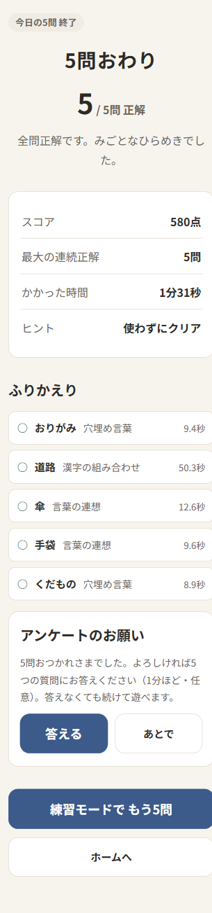

# ことばのひらめき（仮）

**1日3分、言葉でひらめく。**

日本語の漢字・連想・穴埋めを題材にした、スマートフォン向けの短時間パズルゲームです。
将来のiOS・Androidアプリ化と収益化を見据えた、**市場検証用のMVP（最小限の試作品）**です。

- 1回のプレイは約1〜3分（5問）
- アカウント登録なし／広告なし／課金なし／サーバーなし
- データはすべて端末のブラウザ（localStorage）に保存されます



---

## Windowsでの起動手順（PowerShell）

Node.js 18以上が必要です（確認済み: Node v24.21.0 / npm 11.19.0）。

```powershell
# 1. プロジェクトフォルダへ移動
cd "C:\DevFolder\my-claude-config\games\Smartphone app\Casual games\ことばのひらめき（仮）\kotoba-hirameki-game"

# 2. 初回だけ: 依存パッケージを入れる
npm install

# 3. 開発サーバーを起動する
npm run dev
```

起動すると `http://localhost:5173/` が表示されます。ブラウザで開いてください。

### スマートフォン実機で試す

開発サーバーは同じWi-Fi内の端末からも開けるよう設定してあります。
`npm run dev` の出力に表示される **Network** のURL（例: `http://192.168.1.14:5173/`）を
スマートフォンのブラウザで開いてください。

> Windowsのファイアウォールで初回にブロックされた場合は、アクセスを許可してください。

### 本番ビルドで確認する

```powershell
npm run build     # 型チェック + ビルド（dist/ に出力）
npm run preview   # ビルド結果を http://localhost:4173/ で確認
```

### その他のコマンド

| コマンド | 内容 |
| --- | --- |
| `npm run dev` | 開発サーバーを起動 |
| `npm run build` | 型チェック（`tsc --noEmit`）と本番ビルド |
| `npm run preview` | ビルド結果の確認 |
| `npm test` | 自動テストを実行（vitest） |
| `npm run validate` | 問題データの自動検証 |
| `npm run questions:list` | 人が確認するための問題一覧を `docs/questions-review.md` に出力 |
| `npm run check` | 検証 → テスト → ビルドをまとめて実行 |

---

## 遊び方

1. タイトル画面で「あそぶ」
2. 「今日の5問」か「練習モード」を選ぶ
3. 5問に答える（時間制限はありません）
4. 1問ごとに正誤と解説が出る
5. 5問終わると結果が表示される

### モード

#### 今日の5問
- **端末のローカル日付**をもとに、その日の5問が決まります。
- 同じ日なら、何度開いても同じ問題・同じ順番です。
- 日付が変わると新しい5問になります。
- 途中でやめても、同じ日のうちは続きから再開できます。
- 解き終えたあとも練習モードは遊べます。
- 初回プレイに「何日目か」などの条件はありません。いつでも始められます。

#### 練習モード
- 何度でも、1セット5問。
- 直近20問に出た問題を避けて出題します。
- 全問遊び終えても止まりません（候補が尽きたら全体から選び直します）。
- 問題数がセット数に満たない場合は重複を許して5問そろえます。

### パズルの種類

| 種類 | 操作 |
| --- | --- |
| 漢字の組み合わせ | 並んだ漢字をタップして熟語を作り、「決定」。「1文字もどす」「すべて消す」で取り消せます |
| 言葉の連想 | 3つの手がかりから、4つの選択肢を選びます |
| 穴埋め言葉 | `ひ○めき` の `○` に入るひらがな1文字を選びます |

### スコア

単純な加点方式です。**時間では減点しません**（焦らせないため）。

| 条件 | 点数 |
| --- | --- |
| 正解 | +100点 |
| ヒントを使って正解 | +50点 |
| 2問つづけて正解（2問目以降の各問） | +20点 |
| 不正解 | 0点 |

5問すべて正解・ヒントなしで満点の580点です。

### ヒント

各問題に「ヒントを見る」ボタンがあります。回答前ならいつでも使え、広告視聴などの条件はありません。
ヒントは正解をそのまま教えるのではなく、考える助けになる内容にしています（自動検証で「ヒントに正解が含まれていないこと」を確認しています）。

---

## 問題データ

- 合計 **69問**（漢字の組み合わせ 22問 / 言葉の連想 23問 / 穴埋め言葉 24問）
- 外部APIは使わず、ローカルのJSONで管理しています。

```
src/data/
  questions.kanji.json   漢字の組み合わせ
  questions.assoc.json   言葉の連想
  questions.fill.json    穴埋め言葉
  index.ts               読み込み口（実装側はJSONの置き場所を知りません）
```

### 問題を追加するには

該当する JSON にレコードを1件足して、`npm run validate` を実行するだけです。
実装の変更は不要です。

共通の項目:

| 項目 | 内容 |
| --- | --- |
| `id` | 一意の問題ID（`K-023` / `A-024` / `F-025` の形式） |
| `type` | `kanji` / `assoc` / `fill` |
| `prompt` | 問題文（お題） |
| `hint` | ヒントボタンで出す内容 |
| `explanation` | 正誤判定のあとに出す解説 |
| `difficulty` | 1〜3 |
| `category` | 分類タグ（生活・学校・自然 など） |

形式ごとの追加項目:

| 形式 | 項目 |
| --- | --- |
| `kanji` | `tiles`（使用可能な漢字の配列）/ `answer`（正解の熟語） |
| `assoc` | `clues`（手がかり）/ `choices`（4つの選択肢）/ `answer` |
| `fill` | `display`（`○` を1つ含む）/ `choices`（ひらがな4つ）/ `answer`（1文字）/ `word`（完成形） |

---

## 問題品質の検証について

### 自動検証（`npm run validate`）で確かめていること

1. 問題IDが重複していない
2. 必須項目が欠けていない
3. 正解が選択肢・使用可能文字と整合している
   - 漢字: 正解の各文字が、重複も含めて `tiles` から作れる
   - 連想: `answer` が `choices` に含まれる
   - 穴埋め: `display` の `○` に `answer` を入れると `word` に一致する
4. 不正な文字列がない（制御文字・前後の空白・`TODO` などの書き残し）
5. 形式ごとのデータ仕様が守られている
   - お題の「◯文字」と正解の長さが一致する
   - 選択肢の数・重複・文字種
   - ヒントや手がかりに正解がそのまま書かれていない
6. 問題数が足りている（合計60問以上／各形式20問以上）

### 自動検証では確かめられないこと

**この自動検証は形式のチェックです。意味の正しさや、正解が1つに定まることまでは保証できません。**

とくに漢字の組み合わせは、並んだ漢字から正解以外の熟語も作れてしまう場合があります
（例: `花 火 夏 祭 夜 空` からは「火花」「夜空」も作れます）。
これはお題の文章で答えを1つに絞る設計にしていますが、**最終的な判断は人の確認が必要です**。

そのための一覧を次のコマンドで出力できます。

```powershell
npm run questions:list
```

→ `docs/questions-review.md`（全69問の、お題・使える文字・正解・ヒント・解説の一覧と、確認の観点）

現時点では、作成した69問すべてについて「お題が答えを1つに絞れているか」を人の目で見直したうえで収録しています。
不確かだった案は採用せず、より明確な問題に差し替えました。
それでも見落としの可能性はあるため、気づいた点は `docs/open-issues.md` に追記してください。

---

## 市場検証用のログ

### 記録しているイベント

`game_start` / `mode_select` / `question_start` / `answer_submit` / `answer_correct` /
`answer_incorrect` / `hint_used` / `set_complete` / `replay_start` /（補足として `survey_submit`）

各イベントには、必要な範囲で次を付けています。

- 発生時刻（ISO8601）
- 問題ID・問題形式
- モード（今日の5問／練習）
- 回答にかかった時間（ミリ秒）
- 正誤
- ヒント使用の有無
- 匿名のローカル識別子（`p_xxxx` 形式。端末内で生成し、端末内だけで使います）

**氏名・連絡先・位置情報などの個人情報は一切収集しません。**

### 容量の管理

イベントは最新 **500件** まで保持し、超えた分は古いものから捨てます。
書き込みに失敗した場合（容量超過など）は件数を半分に減らして再試行し、それでも駄目ならログを諦めてゲームの進行を優先します。

### 取り出し方

設定画面の「JSONをダウンロード」から、`kotoba-hirameki_YYYY-MM-DD.json` として保存できます。
中身はプレイ記録・日別結果・アンケート回答です。

### ⚠️ 重要な制約

**localStorageに保存しているだけなので、他のプレイヤーのデータを自動で集めることはできません。**

このMVPでデータを集めるには、テストしてくれた人に

1. 設定画面からJSONをダウンロードしてもらい
2. そのファイルを送ってもらう

という手順をお願いする必要があります。
自動で集計したい場合は、別途バックエンド（データの送信先）が必要になります。

---

## アンケート

初回の5問が終わったあと、結果画面に任意のアンケートの案内が出ます。
「あとで」を選んでもゲームは続けられ、設定画面からいつでも回答・修正できます。

質問は5つです。

1. このゲームは面白かったですか？（5段階）
2. また遊びたいですか？（はい・いいえ）
3. 難易度はどうでしたか？（簡単・ちょうどよい・難しい）
4. どの問題形式が一番好きですか？
5. 改善してほしい点はありますか？（自由入力）

回答は端末に保存され、上記のJSON出力に含まれます。

---

## 保存しているもの（localStorage）

| キー | 内容 |
| --- | --- |
| `kotoba-hirameki:save:v1` | 今日の問題の進捗 / 練習モードの最高記録 / 累計正解数 / プレイ回数 / 最終プレイ日 / 過去の日別結果（最新60日） / サウンド設定 / アンケート回答 |
| `kotoba-hirameki:events:v1` | プレイログ（最新500件） |

保存データが壊れていた場合は、**項目ごとに型を確かめて初期値に戻す**ため、アプリが止まることはありません
（壊れたJSON・配列・数値・一部だけ型違い、などをテストで確認しています）。
`localStorage` が使えない環境では、メモリ上の保存に自動で切り替えて動作を継続します。

端末間の同期はありません。

---

## 画面一覧

1. タイトル画面
2. モード選択画面
3. 問題プレイ画面
4. 正誤結果画面
5. 5問終了画面
6. 過去の記録画面
7. 設定画面
8. アンケート画面

---

## サウンド

効果音は音声ファイルを使わず、**Web Audio APIで波形を合成**しています（著作権の心配がなく、読み込み待ちもありません）。

- 正解音 / 不正解音 / ボタン操作音 / 5問クリア音
- 設定画面でオン・オフを切り替えられます
- ブラウザの自動再生制限に従い、`AudioContext` は**最初のタップ・クリックが起きるまで作りません**。
  そのため、起動後の最初の1回だけ音が鳴らないことがあります。

---

## 技術構成

- TypeScript（strict）+ Vite 5
- フレームワークなし（素のDOM操作）
- 依存パッケージは開発用のみ（vite / typescript / vitest / vite-node / jsdom / @types/node）
- バックエンド・データベースなし
- 有料APIなし

```
src/
  main.ts              起動
  app.ts               ゲーム本体（状態と画面遷移）
  types.ts             型定義
  styles.css           見た目
  data/                問題データ（JSON）と読み込み口
  lib/
    rng.ts             日付から再現できる乱数・日付キー
    selection.ts       今日の5問／練習モードの出題選び
    scoring.ts         点数と集計
    storage.ts         localStorage（壊れても落ちない読み込み）
    analytics.ts       プレイログとJSON出力
    audio.ts           Web Audioによる効果音
    validate.ts        問題データの検証ルール
    dom.ts             画面を組み立てる小道具
  screens/             画面8種
scripts/
  validate-questions.ts     問題データの自動検証
  export-question-list.ts   人の確認用の問題一覧を出力
tests/                 自動テスト（vitest）
docs/                  問題一覧・テスト結果・未解決の問題
```

---

## テスト結果

`npm test` で **5ファイル・76テストすべて成功**しています。詳細は [docs/test-results.md](docs/test-results.md) を参照してください。

**スマートフォン実機での動作は未確認です。** PCのChrome（Playwright）で幅320px・375pxでの表示と操作は確認済みです。

未解決の課題は [docs/open-issues.md](docs/open-issues.md) にまとめています。

---

## 将来のアプリ化について（概要）

このMVPはWeb技術だけで作ってあるため、次の順で広げられます。

1. **PWA化**（最小の手間）
   `manifest.json` とサービスワーカーを足せば、ホーム画面に追加してオフラインで遊べます。ストア審査は不要です。
2. **Capacitorでネイティブ化**
   `npx cap add ios` / `npx cap add android` で、今のWeb資産をそのままApp Store・Google Playに出せる形にできます。
   広告（AdMob）や課金はこの段階でプラグインとして足します。
3. **データ収集のサーバー化**
   現在のイベントログの形（`src/lib/analytics.ts` の `GameEvent`）のまま送信先を足せば、プレイヤー全体の傾向を集計できます。

いずれも今回のMVPの範囲外です。市場検証の結果を見てから判断してください。

---

## 判断したこと・決めごと（仕様に明記がなかった点）

- **問題数は69問**にしました（最低60問の要件に対し、各形式20問以上＋予備）。
- **スコアの計算式**は仕様に指定がなかったため、「正解100点／ヒント使用50点／連続正解ボーナス+20点」の単純な加算にしました。
- **アンケートの表示タイミング**は、結果画面を見てから判断できるよう、初回の5問終了画面に案内カードとして出す形にしました（画面を強制的に切り替えません）。
- **データ削除の確認**は、ブラウザのダイアログ（`confirm`）を使わず画面内の2段階ボタンにしました。
- **日付の改ざん・端末間同期の防止はMVPの対象外です。** 端末の日付を変えれば別の「今日の5問」を出せますし、別の端末では記録が共有されません。

---

## ライセンス・素材について

- 画像・音声の外部素材は使用していません（効果音はコードで生成）。
- フォントは端末の標準フォントのみを指定しています。
- 問題文・解説はこのプロジェクトのために書き下ろしたものです。
